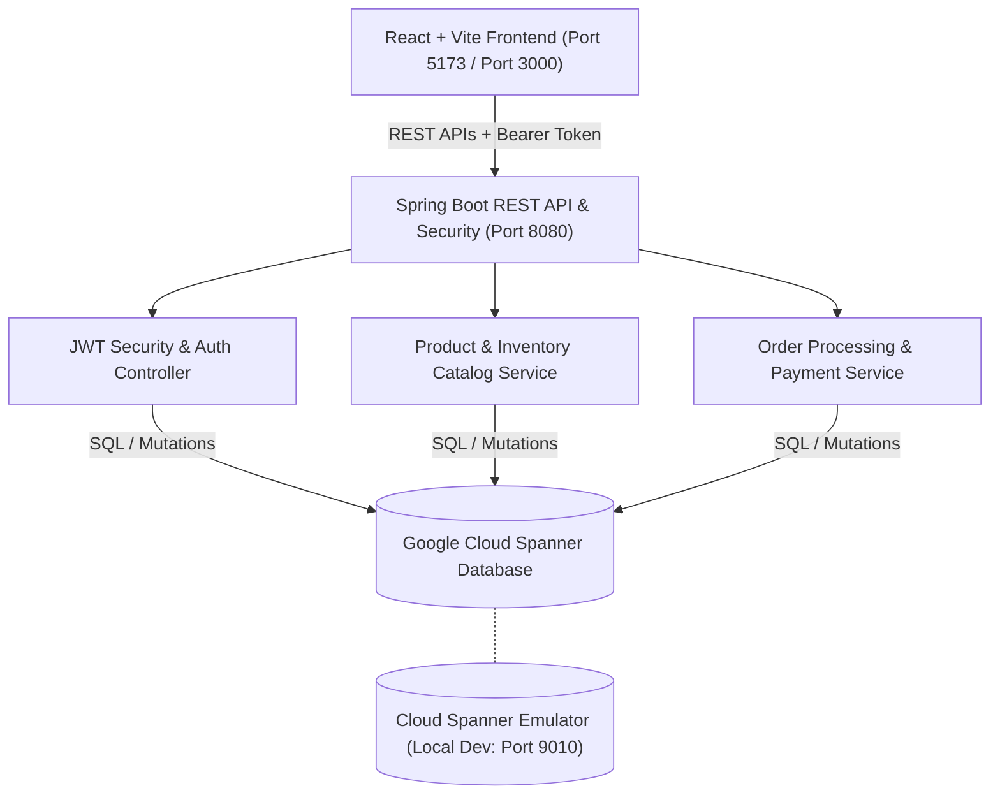

# GlobalCart — Spring Boot & Google Cloud Spanner Architecture & GCP Certification Blueprint

## 1. Executive Summary & System Architecture

**GlobalCart** is an enterprise luxury fashion & lifestyle marketplace built with a modern decoupled architecture:
- **Frontend**: React + Vite + Tailwind CSS (`logancee-frontend`)
- **Backend Services**: Java 21 + Spring Boot 3.3 + Spring Security (`globalcart-backend`)
- **Database Layer**: **Google Cloud Spanner** (Local Emulator for development; Regional / Multi-Region Spanner Instance for GCP Production)



---

## 2. Google Cloud Spanner Data Modeling & Schema Design

Cloud Spanner is a globally distributed, synchronously replicated SQL database that delivers **99.999% availability (five nines)**, **linear horizontal scalability**, and **ACID transactional consistency** across regions.

### Key Architectural Choices in Spanner Schema:

1. **Distributed Key Design**:
   - Primary keys use UUIDs or hash-prefixed strings (`user-101`, `ord-1001`, `prod-1`) to avoid hot-spotting on sequential monotonically increasing auto-increment integers.
2. **Interleaved Tables (Parent-Child Co-location)**:
   - Child entities (e.g., `UserAddresses`, `CartItems`, `OrderItems`, `OrderStatusTimeline`, `ProductImages`, `ProductColorOptions`) are defined using `INTERLEAVE IN PARENT ... ON DELETE CASCADE`.
   - **Performance Benefit**: Interleaving co-locates child row data in the exact same physical Spanner split directory as parent rows. Single-shard transactions and joins execute locally within a single node without cross-region commit latency.

### Complete Spanner DDL Schema (`schema.sql`):

```sql
-- USERS TABLE (Root)
CREATE TABLE Users (
    user_id STRING(64) NOT NULL,
    email STRING(255) NOT NULL,
    password_hash STRING(255) NOT NULL,
    name STRING(255) NOT NULL,
    phone STRING(32),
    avatar_url STRING(512),
    role STRING(32) NOT NULL,
    created_at TIMESTAMP NOT NULL OPTIONS (allow_commit_timestamp=true)
) PRIMARY KEY (user_id);

CREATE UNIQUE INDEX idx_users_email ON Users(email);

-- USER ADDRESSES (Interleaved inside Users)
CREATE TABLE UserAddresses (
    user_id STRING(64) NOT NULL,
    address_id STRING(64) NOT NULL,
    full_name STRING(255) NOT NULL,
    street STRING(512) NOT NULL,
    city STRING(128) NOT NULL,
    state STRING(128) NOT NULL,
    zip_code STRING(32) NOT NULL,
    country STRING(128) NOT NULL,
    phone STRING(32) NOT NULL,
    is_default BOOL NOT NULL,
    address_type STRING(32) NOT NULL
) PRIMARY KEY (user_id, address_id),
  INTERLEAVE IN PARENT Users ON DELETE CASCADE;

-- PRODUCTS TABLE
CREATE TABLE Products (
    product_id STRING(64) NOT NULL,
    sku STRING(64) NOT NULL,
    name STRING(255) NOT NULL,
    brand STRING(128) NOT NULL,
    category STRING(128) NOT NULL,
    subcategory STRING(128) NOT NULL,
    description STRING(4096) NOT NULL,
    price NUMERIC NOT NULL,
    original_price NUMERIC NOT NULL,
    discount_percentage INT64 NOT NULL,
    rating FLOAT64 NOT NULL,
    review_count INT64 NOT NULL,
    stock_quantity INT64 NOT NULL,
    in_stock BOOL NOT NULL,
    hover_image_url STRING(512),
    is_new BOOL NOT NULL,
    is_trending BOOL NOT NULL,
    is_bestseller BOOL NOT NULL,
    is_flash_sale BOOL NOT NULL,
    flash_sale_end_time TIMESTAMP,
    specifications_json STRING(MAX),
    size_and_fit STRING(2048),
    shipping_info STRING(2048),
    return_policy STRING(2048),
    created_at TIMESTAMP NOT NULL OPTIONS (allow_commit_timestamp=true)
) PRIMARY KEY (product_id);

CREATE INDEX idx_products_category ON Products(category);
CREATE INDEX idx_products_brand ON Products(brand);
CREATE UNIQUE INDEX idx_products_sku ON Products(sku);

-- ORDERS TABLE & INTERLEAVED ITEMS
CREATE TABLE Orders (
    order_id STRING(64) NOT NULL,
    order_number STRING(64) NOT NULL,
    user_id STRING(64) NOT NULL,
    shipping_address_json STRING(MAX) NOT NULL,
    payment_method STRING(32) NOT NULL,
    payment_status STRING(32) NOT NULL,
    order_status STRING(64) NOT NULL,
    subtotal NUMERIC NOT NULL,
    discount NUMERIC NOT NULL,
    shipping_fee NUMERIC NOT NULL,
    tax NUMERIC NOT NULL,
    total_amount NUMERIC NOT NULL,
    created_at TIMESTAMP NOT NULL OPTIONS (allow_commit_timestamp=true),
    estimated_delivery STRING(128) NOT NULL,
    tracking_number STRING(128)
) PRIMARY KEY (order_id);

CREATE INDEX idx_orders_user_id ON Orders(user_id);
CREATE UNIQUE INDEX idx_orders_order_number ON Orders(order_number);

CREATE TABLE OrderItems (
    order_id STRING(64) NOT NULL,
    item_id STRING(64) NOT NULL,
    product_id STRING(64) NOT NULL,
    product_name STRING(255) NOT NULL,
    product_image STRING(512) NOT NULL,
    brand STRING(128) NOT NULL,
    color STRING(64) NOT NULL,
    size STRING(32) NOT NULL,
    quantity INT64 NOT NULL,
    unit_price NUMERIC NOT NULL,
    total_price NUMERIC NOT NULL
) PRIMARY KEY (order_id, item_id),
  INTERLEAVE IN PARENT Orders ON DELETE CASCADE;
```

---

## 3. REST API Contract & Frontend Compatibility Specification

All REST API endpoints match the existing React frontend client expectations without modifying frontend interface contracts.

| Category | HTTP Method | Endpoint | Description | Auth Required |
| :--- | :--- | :--- | :--- | :--- |
| **Auth** | `POST` | `/api/auth/login` | Authenticate user & issue JWT | Public |
| **Auth** | `POST` | `/api/auth/register` | Register new user account | Public |
| **Auth** | `POST` | `/api/auth/forgot-password` | Dispatch reset instructions | Public |
| **Auth** | `POST` | `/api/auth/logout` | Client session termination | Public |
| **Users** | `GET` | `/api/users/me` | Fetch authenticated user profile | Bearer Token |
| **Users** | `GET` | `/api/users/me/addresses` | List saved addresses | Bearer Token |
| **Users** | `POST` | `/api/users/me/addresses` | Add new shipping address | Bearer Token |
| **Products** | `GET` | `/api/products` | Paginated product listing & filters | Public |
| **Products** | `GET` | `/api/products/{id}` | Product detail lookup | Public |
| **Products** | `GET` | `/api/products/search?q=`| Fulltext search across products | Public |
| **Cart** | `GET` | `/api/cart` | Retrieve shopping bag | Bearer Token |
| **Cart** | `POST` | `/api/cart/items` | Add product to cart | Bearer Token |
| **Cart** | `POST` | `/api/cart/coupon` | Apply promo code (`WELCOME20`) | Bearer Token |
| **Orders** | `POST` | `/api/orders` | Checkout & place order | Bearer Token |
| **Orders** | `GET` | `/api/orders` | Fetch user order history | Bearer Token |
| **Orders** | `GET` | `/api/orders/{id}` | Order timeline & details | Bearer Token |
| **Admin** | `GET` | `/api/admin/dashboard` | Analytics metrics & charts | Admin Role |
| **Admin** | `GET` | `/api/admin/products` | Admin product management | Admin Role |

---

## 4. Local Emulator Setup & GCP Cloud Deployment Guide

### Option A: Local Cloud Spanner Emulator Setup (Docker)

1. Start Google Cloud Spanner Emulator container:
```bash
docker run -d --name spanner-emulator \
  -p 9010:9010 -p 9020:9020 \
  gcr.io/cloud-spanner-emulator/emulator
```

2. Initialize Spanner Instance & Database using `gcloud` CLI:
```bash
# Configure gcloud endpoint to local emulator
gcloud config set api_endpoint_overrides/spanner http://localhost:9020/
gcloud config set project globalcart-dev-project

# Create Instance & Database
gcloud spanner instances create globalcart-spanner-instance \
  --config=emulator-config --description="Local Dev Spanner" --nodes=1

gcloud spanner databases create globalcart_db \
  --instance=globalcart-spanner-instance \
  --ddl-file=src/main/resources/schema.sql
```

### Option B: Deploying Spring Boot Backend to GCP (Cloud Run / GKE)

1. Build OCI Container image:
```bash
docker build -t gcr.io/YOUR_GCP_PROJECT/globalcart-backend:1.0.0 .
docker push gcr.io/YOUR_GCP_PROJECT/globalcart-backend:1.0.0
```

2. Deploy to GCP Cloud Run with IAM Managed Identity (Spanner Database User Role):
```bash
gcloud run deploy globalcart-backend \
  --image gcr.io/YOUR_GCP_PROJECT/globalcart-backend:1.0.0 \
  --region asia-south1 \
  --allow-unauthenticated \
  --set-env-vars="GCP_PROJECT_ID=YOUR_GCP_PROJECT,SPANNER_INSTANCE_ID=globalcart-prod-instance,SPANNER_DATABASE_ID=globalcart_prod_db,USE_SPANNER_EMULATOR=false"
```

---

## 5. Security & Multi-Tenant Data Protection

- **BCrypt Password Hashing**: Passwords stored using strength 10 salt rounds.
- **Stateless JWT Authorization**: Bearer tokens valid for 24 hours, checked on every API request via `JwtAuthenticationFilter`.
- **Server-Side Price & Inventory Guard**: Total amounts and discounts are computed authoritatively on the Spring Boot backend using Cloud Spanner database prices to prevent client-side HTTP payload tampering.
